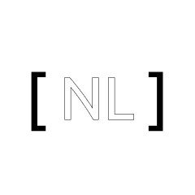

  
  <h1>None Labs</h1>
  
<em>오픈소스 R&D, 한국어 고밀도 NLP & 시스템 아키텍처 연구 조직</em>

 

**None Labs**는 한국어 고밀도 자연어 처리(NLP), 화자 의도 및 뉘앙스 분석 엔진, 이상심리 연구 및 핵심 인프라 기술을 연구·개발하는 오픈소스 R&D 조직입니다.

---

## 🛠️ 기술 원칙 (Core Principles)
- **비용 최우선 (Cost-First)**: 경량 인프라 및 최적화된 연산 구조 설계
- **Pure Golang Core**: 고성능 저지연 아키텍처 및 CPU 최적화 구현
- **지식 공유 & 기록**: ADR 및 체계적인 이슈/위키 기반 의사결정 추적

---
* **Project Manager / Owner**: limmireu1214@gmail.com (@Mireu-Lab)

